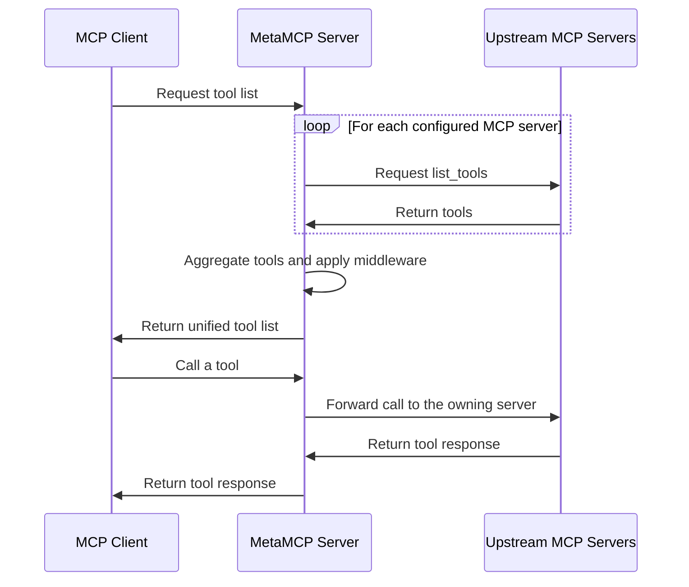

# 🚀 MetaMCP

<div align="center">
  <a href="https://discord.gg/mNsyat7mFX" style="text-decoration: none;">
    
  </a>
  <a href="https://docs.metamcp.com" style="text-decoration: none;">
    
  </a>
  <a href="https://opensource.org/licenses/MIT" style="text-decoration: none;">
    
  </a>
  <a href="https://github.com/metatool-ai/metamcp/pkgs/container/metamcp" style="text-decoration: none;">
    
  </a>
</div>

<div align="center">

**Aggregate, organize, secure, and expose multiple MCP servers through one deployable gateway.**

[Documentation](https://docs.metamcp.com) · [Quick demo](https://youtu.be/Cf6jVd2saAs) · [Discord](https://discord.gg/mNsyat7mFX) · [GitHub Issues](https://github.com/metatool-ai/metamcp/issues)

English · [中文](./README_cn.md)

</div>

> **Project status:** Development may move slowly, but MetaMCP remains maintained. The current focus is on reviewing and merging community contributions. See [Recent updates](recent-updates.md) for more context.

MetaMCP is both an **MCP proxy** and an **MCP server**. It combines upstream MCP servers into unified, namespaced endpoints; lets you select and customize the tools each endpoint exposes; and applies middleware before requests reach clients.

MetaMCP endpoints can be consumed by any compatible MCP client through **Streamable HTTP**, **SSE**, or **OpenAPI**.


## Table of contents

- [Why MetaMCP](#why-metamcp)
- [How MetaMCP is organized](#how-metamcp-is-organized)
- [Quick start](#quick-start)
- [Connect an MCP client](#connect-an-mcp-client)
- [Configure upstream MCP servers](#configure-upstream-mcp-servers)
- [Shape and inspect your tool surface](#shape-and-inspect-your-tool-surface)
- [Authentication and access control](#authentication-and-access-control)
- [Traffic management](#traffic-management)
- [Deployment and operations](#deployment-and-operations)
- [Development](#development)
- [Protocol compatibility and architecture](#protocol-compatibility-and-architecture)
- [Roadmap](#roadmap)
- [Community and project information](#community-and-project-information)

## Why MetaMCP

Use MetaMCP when you need a stable layer between MCP clients and a changing set of upstream MCP servers.

- **Compose servers into focused endpoints.** Group one or more MCP servers into namespaces, then expose each namespace through a client-facing endpoint.
- **Reduce tool overload.** Enable only the tools a client or agent needs instead of sending every available tool into the model context.
- **Customize tool metadata.** Override tool names, titles, descriptions, and annotations for each namespace without changing the upstream server.
- **Support multiple client types.** Expose the same namespace through Streamable HTTP, SSE, and OpenAPI.
- **Centralize access control.** Use API keys, MCP OAuth, OIDC-based SSO, public/private ownership scopes, and registration controls.
- **Inspect and troubleshoot centrally.** Save MCP server configurations, inspect tools and resources, and review live behavior from one interface.
- **Apply infrastructure controls.** Add middleware, rate limits, session prewarming, and deployment-specific dependencies at the gateway layer.

Developers can use MetaMCP as infrastructure for dynamically composed MCP servers and build agents on top of a consistent endpoint surface.


## How MetaMCP is organized

MetaMCP uses three primary building blocks:

| Building block | Purpose |
| --- | --- |
| **MCP Server** | Stores the connection configuration for an upstream MCP server, including its transport, command, arguments, headers, or environment variables. |
| **Namespace** | Groups one or more MCP servers, controls which tools are enabled, applies middleware, and stores namespace-specific tool overrides. |
| **Endpoint** | Exposes a namespace to clients through Streamable HTTP, SSE, or OpenAPI, with optional API-key or OAuth authentication. |

Two supporting features make those building blocks easier to operate:

- **Middleware** intercepts and transforms MCP requests or responses at the namespace level.
- **Inspector** provides saved configurations for testing upstream servers and MetaMCP endpoints without rebuilding connection details each time.

A typical flow is:

```text
MCP servers → Namespace → Endpoint → MCP client
```

You can change which namespace an endpoint uses without asking clients to adopt a new endpoint URL.

## Quick start

### Prerequisites

- Docker
- Docker Compose
- Git

### 1. Start MetaMCP

```bash
git clone https://github.com/metatool-ai/metamcp.git
cd metamcp
cp example.env .env
docker compose up -d
```

Open [http://localhost:12008](http://localhost:12008), then create an account or sign in with the bootstrapped credentials configured in `.env`.

> **Production setup:** Change `POSTGRES_PASSWORD`, `BETTER_AUTH_SECRET`, and any bootstrapped passwords before deployment. Use HTTPS for publicly accessible instances.

### 2. Create your first endpoint

Use the web interface to complete this sequence:

1. **Add an MCP server** and confirm that MetaMCP can connect to it.
2. **Create a namespace** and add the server.
3. **Review the namespace tools** and disable anything the endpoint should not expose.
4. **Create an endpoint** and assign the namespace.
5. **Generate an API key** if endpoint authentication is enabled.
6. **Connect a client** using one of the endpoint URLs shown below.

The complete walkthrough is available in the [Quick Start documentation](https://docs.metamcp.com/en/quickstart).

### Important setup notes

- MetaMCP enforces CORS against `APP_URL`. If you change `APP_URL`, access the application from that exact origin or configure trusted origins appropriately.
- The default PostgreSQL volume is named `postgres_data`. Rename it in `docker-compose.yml` if it conflicts with another Compose project on the same host.

## Connect an MCP client

Each endpoint exposes the following URL formats:

| Transport | URL | Best fit |
| --- | --- | --- |
| **Streamable HTTP** | `/metamcp/<ENDPOINT_NAME>/mcp` | Recommended for modern MCP clients |
| **SSE** | `/metamcp/<ENDPOINT_NAME>/sse` | Compatibility with clients that still use SSE |
| **OpenAPI** | `/metamcp/<ENDPOINT_NAME>/api` | REST/OpenAPI clients such as Open WebUI |
| **OpenAPI schema** | `/metamcp/<ENDPOINT_NAME>/api/openapi.json` | Client generation and schema inspection |

Replace `<ENDPOINT_NAME>` with the endpoint name created in MetaMCP. API keys use the format `sk_mt_...`.

### Cursor and other remote-capable clients

Streamable HTTP is recommended:

```json
{
  "mcpServers": {
    "MetaMCP": {
      "url": "http://localhost:12008/metamcp/<ENDPOINT_NAME>/mcp",
      "headers": {
        "Authorization": "Bearer <YOUR_API_KEY>"
      }
    }
  }
}
```

Remove the `headers` block when authentication is disabled for the endpoint.

### Claude Desktop and other STDIO-only clients

MetaMCP endpoints are remote-only. A client that supports only STDIO needs a local bridge. Although `mcp-remote` is sometimes suggested for this purpose, it is designed for OAuth-based authentication and does not work with MetaMCP's API-key authentication; based on testing, `mcp-proxy` is the recommended option.

```json
{
  "mcpServers": {
    "MetaMCP": {
      "command": "uvx",
      "args": [
        "mcp-proxy",
        "--transport",
        "streamablehttp",
        "http://localhost:12008/metamcp/<ENDPOINT_NAME>/mcp"
      ],
      "env": {
        "API_ACCESS_TOKEN": "<YOUR_API_KEY>"
      }
    }
  }
}
```

An SSE bridge is also supported:

```json
{
  "mcpServers": {
    "MetaMCP": {
      "command": "uvx",
      "args": [
        "mcp-proxy",
        "http://localhost:12008/metamcp/<ENDPOINT_NAME>/sse"
      ],
      "env": {
        "API_ACCESS_TOKEN": "<YOUR_API_KEY>"
      }
    }
  }
}
```

For more context and alternative approaches, see [issue #76](https://github.com/metatool-ai/metamcp/issues/76#issuecomment-3046707532).

### API-key troubleshooting

- Prefer the `Authorization: Bearer <API_KEY>` header.
- Query-parameter authentication with `?api_key=` works with Streamable HTTP and OpenAPI, but not SSE.
- To isolate authentication problems, temporarily test the endpoint with authentication disabled, then re-enable it after the connection succeeds.

## Configure upstream MCP servers

An MCP server record tells MetaMCP how to connect to an upstream server. For example, a STDIO configuration may use:

```json
{
  "HackerNews": {
    "type": "STDIO",
    "command": "uvx",
    "args": ["mcp-hn"]
  }
}
```

### Environment variables and secrets for STDIO servers

MetaMCP supports three patterns.

#### 1. Raw values

Use direct values for non-sensitive configuration:

```text
DEBUG=true
```

Avoid storing secrets this way when possible.

#### 2. Environment-variable references

Reference variables from the MetaMCP container with `${ENV_VAR_NAME}` syntax:

```text
API_KEY=${OPENAI_API_KEY}
DATABASE_URL=${DB_CONNECTION_STRING}
```

The reference is resolved at runtime, keeping the secret itself out of the saved server configuration and repository.

#### 3. Automatic matching

When an upstream server expects an environment variable that already exists under the same name in the MetaMCP container, you can omit it from the server configuration. MetaMCP passes matching variables through automatically.

> **Local development:** When using `pnpm run dev:docker`, add required variables to `globalEnv` in `turbo.json` so Turbo passes them to development processes. Production Docker deployments do not require this step.

## Shape and inspect your tool surface

### Namespaces

A namespace can:

- combine one or more MCP servers;
- enable or disable an entire server;
- enable or disable individual tools;
- apply middleware to MCP requests and responses; and
- store tool metadata overrides that apply only within that namespace.

### Tool overrides and annotations

Open a namespace and select the **Tools** tab to edit saved tool metadata inline. You can override:

- tool name;
- display title;
- description; and
- MCP annotations, such as `{ "annotations": { "readOnlyHint": false } }`.

Annotation overrides are merged with metadata returned by the upstream server, so namespace-specific hints do not remove unrelated provider metadata. The interface marks tools with active overrides or annotations.

### Middleware

Middleware runs at the namespace level and can intercept or transform MCP requests and responses. The built-in **Filter inactive tools** middleware keeps disabled tools out of the client-visible tool list and reduces unnecessary model context.

Additional middleware areas may include logging, error tracing, validation, and security scanning.

### Inspector

The built-in inspector is similar to the official MCP Inspector, but it retains server configurations. MetaMCP can therefore generate ready-to-use inspection settings for both upstream servers and exposed endpoints.

## Authentication and access control

MetaMCP supports several complementary security layers:

- **Better Auth** for the frontend and backend;
- **session cookies** for secure internal proxy connections;
- **API keys** for external endpoint access;
- **MCP OAuth** for endpoints using the OAuth flow defined in the MCP specification;
- **OIDC-based SSO** for organizational identity providers;
- **public and private ownership scopes** for MCP servers, namespaces, endpoints, and API keys; and
- **separate registration controls** for form-based and SSO-based account creation.

Public API keys cannot access private MetaMCP resources.

### OpenID Connect configuration

Add the following variables to `.env` to enable OIDC:

```bash
OIDC_CLIENT_ID=your-oidc-client-id
OIDC_CLIENT_SECRET=your-oidc-client-secret
OIDC_DISCOVERY_URL=https://your-provider.com/.well-known/openid-configuration
# Currently required due to a known better-auth issue (better-auth#3278)
OIDC_AUTHORIZATION_URL=https://your-provider.com/auth/authorize

# Optional
OIDC_PROVIDER_ID=oidc
OIDC_SCOPES=openid email profile
OIDC_PKCE=true
```

The callback URL is:

```text
${APP_URL}/api/auth/oauth2/callback/oidc
```

MetaMCP uses the authorization-code flow, enables PKCE by default, and creates users automatically on first successful sign-in. It has been used with providers such as Auth0, Keycloak, Azure AD, Google, and Okta.

See [CONTRIBUTING.md](CONTRIBUTING.md#openid-connect-oidc-provider-setup) for provider setup and troubleshooting details.

### Registration controls

Administrators can control the two signup paths independently from **Settings → Authentication Settings**:

| Control | Effect |
| --- | --- |
| **Disable UI Registration** | Blocks new accounts created through the registration form. |
| **Disable SSO Registration** | Blocks new accounts created through OAuth or OIDC providers. |

This supports common enterprise policies, including SSO-only access, manually provisioned accounts, or a complete registration freeze.

## Traffic management

MetaMCP provides token-bucket rate limits at two levels:

| Limit | Counter scope | Response when exceeded |
| --- | --- | --- |
| **Endpoint rate limit** | Shared by all clients using an endpoint | `503 Service Unavailable` |
| **Client rate limit** | Separate counter for each client and endpoint | `429 Too Many Requests` |

Both limits can be enabled together.

### Endpoint rate-limit settings

- **Max Rate:** Total request tokens available to all clients sharing the endpoint.
- **Max Rate Seconds:** Refill interval for the shared token bucket. For example, a max rate of `5` over `60` seconds permits five requests per minute across all clients.

### Client rate-limit settings

- **Client Max Rate:** Request tokens available to each individual client.
- **Client Max Rate Seconds:** Refill interval for each client-specific token bucket.
- **Client Max Rate Strategy:** Identifies clients by IP address or by a selected request header.
- **Client Max Rate Strategy Key:** Header name used when the header strategy is selected, such as `Authorization` or `X-Original-Forwarded-For`.

Rate-limit counters are stored in memory. In a multi-node deployment, each node counts only the traffic that reaches that node.

## Deployment and operations

### Production checklist

- Use an instance with at least **2–4 GB of memory**; larger deployments may benefit from additional capacity.
- Change the default database, authentication, and bootstrapped-user secrets.
- Serve public deployments over HTTPS.
- Set `APP_URL` and `NEXT_PUBLIC_APP_URL` to the public application origin.
- Configure `EXTRA_TRUSTED_ORIGINS` when additional trusted origins are required.
- Review registration controls after creating the intended administrator and team accounts.

### Reverse proxy and SSE

SSE uses long-lived connections. When deploying behind Nginx, start from [nginx.conf.example](nginx.conf.example) and preserve settings needed for streaming connections.

### Cold starts and custom dependencies

MetaMCP preallocates idle sessions for configured MCP servers and MetaMCP compositions. The default idle-session count is one, which helps reduce cold-start latency.

When an upstream MCP server requires dependencies beyond the packages already available in the image, customize the Dockerfile to install those dependencies. Preinstalling commonly used packages can also reduce startup time.

See [invalidation.md](invalidation.md) for the session-invalidation sequence used during configuration updates.

### Log levels

The backend writes logs to files and can mirror selected levels to the console.

| Destination | Included levels |
| --- | --- |
| `app.log` | `DEBUG`, `INFO`, `WARN` |
| `error.log` | `ERROR` |

Set `LOG_LEVEL` to control console output:

| Value | Console output |
| --- | --- |
| `all` | `DEBUG`, `INFO`, `WARN`, `ERROR` |
| `info` | `INFO` only |
| `errors-only` | `WARN` and `ERROR` |
| `none` | No console output |

The default is `errors-only` when the variable is unset or invalid.

```bash
LOG_LEVEL='errors-only' # 'all', 'info', 'errors-only', 'none'
```

`docker-compose.dev.yml` defaults to `all` for development.

## Development

### Dev Containers with VS Code or Cursor

A Dev Container provides the full toolchain without requiring local project dependencies beyond Docker and an editor with Dev Containers support.

```bash
git clone https://github.com/metatool-ai/metamcp.git
cd metamcp
code .
```

In the editor command palette, run **Dev Containers: Reopen in Container**. After the container finishes building and dependencies are installed, start the development server:

```bash
pnpm dev
```

The first build downloads images and packages, so a reliable connection to Docker Hub and GitHub is required.

### Docker development with hot reload

```bash
cp example.env .env
pnpm run dev:docker
```

Related commands:

```bash
pnpm run dev:docker:down   # Stop the development environment
pnpm run dev:docker:clean  # Stop it and remove volumes
```

### Local development

Local development requires Node.js 18 or later, pnpm, and an accessible PostgreSQL instance. Running PostgreSQL through Docker remains the easiest setup.

```bash
cp example.env .env
pnpm install
pnpm dev
```

See [CONTRIBUTING.md](CONTRIBUTING.md) for the full contribution workflow.

## Protocol compatibility and architecture

### MCP compatibility

- Tools, resources, and prompts are supported.
- Upstream OAuth-enabled MCP servers have been tested against the 2025-03-26 protocol revision.
- Exposed endpoints can use the standard MCP OAuth flow from the 2025-06-18 specification.
- Remote endpoints are available through Streamable HTTP and SSE.
- OpenAPI endpoints support clients such as [Open WebUI](https://github.com/open-webui/open-webui).
- STDIO-only clients can connect through a local proxy.

Questions and compatibility reports are welcome through [GitHub Issues](https://github.com/metatool-ai/metamcp/issues).

### Application architecture

- **Frontend:** Next.js
- **Backend:** Express.js and tRPC, using the MCP TypeScript SDK and an internal proxy
- **Authentication:** Better Auth
- **Repository:** Standalone Turborepo monorepo
- **Deployment:** Docker images published through GitHub Container Registry

### Request flow

Prompts and resources follow the same general flow as tools.



## Roadmap

Potential next steps include:

- [ ] Headless administration API
- [ ] Dynamic search rules for MetaMCP endpoints
- [ ] Additional middleware
- [ ] Chat and agent playground
- [ ] Testing and evaluation for MCP tool-selection optimization
- [ ] Dynamic MCP server generation

## Community and project information

### Internationalization

English and Chinese are currently supported. Contributions for additional locales are welcome. See [README-i18n.md](README-i18n.md).

### Contributing

Contributions are welcome. Read [CONTRIBUTING.md](CONTRIBUTING.md) before opening a pull request.

### License

MetaMCP is released under the [MIT License](LICENSE).

A backlink or acknowledgment is appreciated when another project uses this code.

### Credits

Parts of the project were inspired by:

- [MCP Inspector](https://github.com/modelcontextprotocol/inspector)
- [MCP Proxy Server](https://github.com/adamwattis/mcp-proxy-server)
- [Open WebUI OpenAPI Servers](https://github.com/open-webui/openapi-servers)
- [mcpo](https://github.com/open-webui/mcpo)
